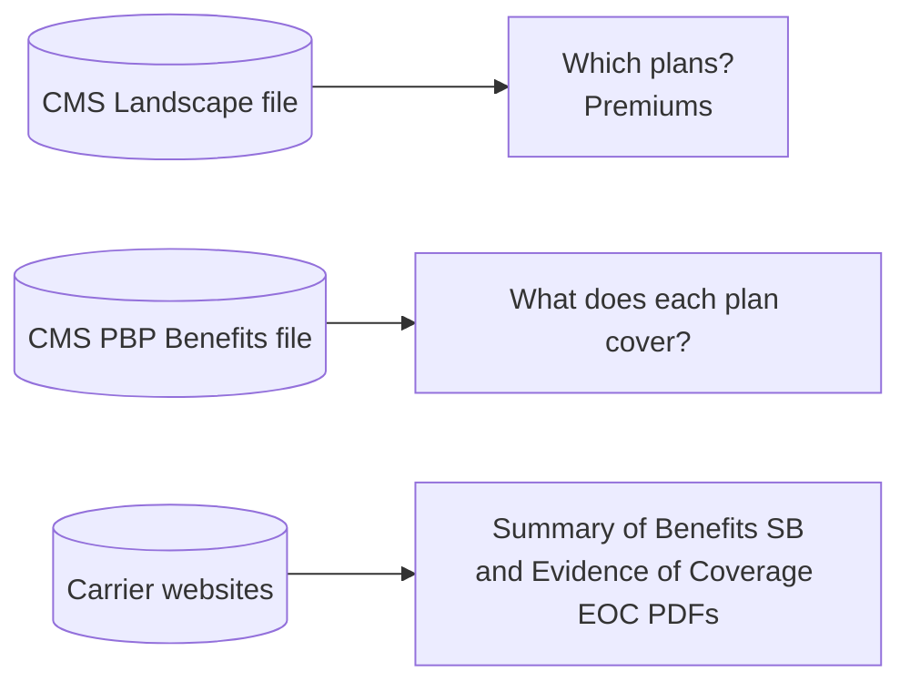
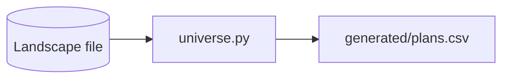
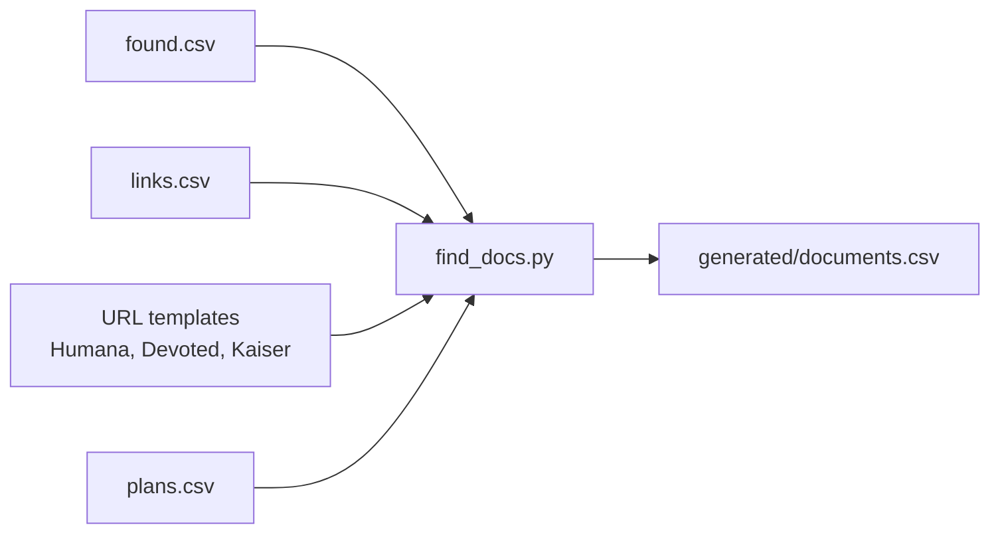
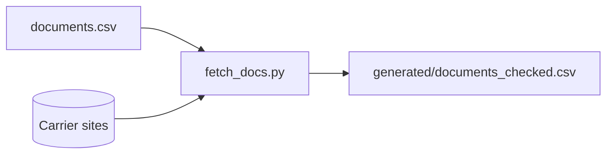
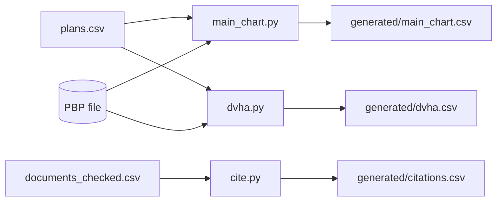
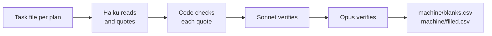
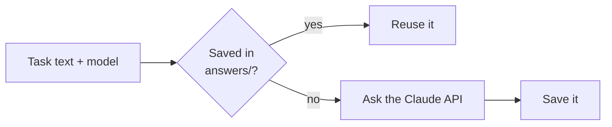
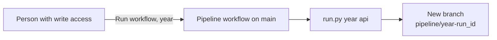
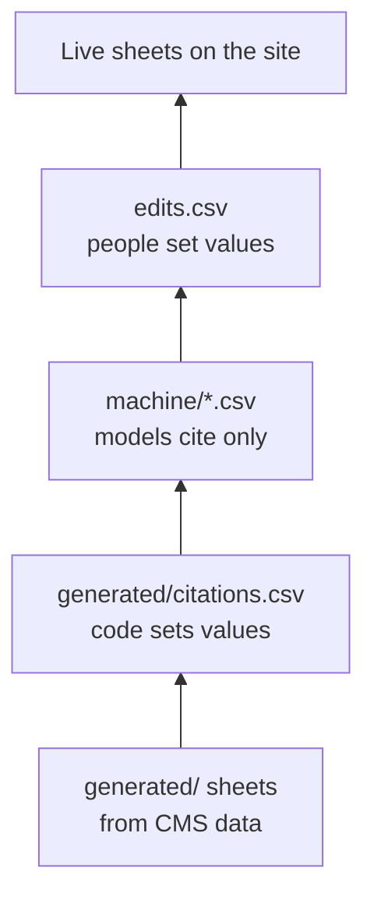
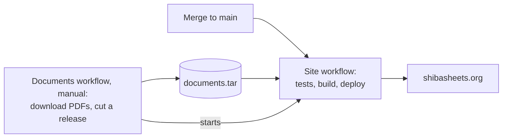

# The data pipeline, one step at a time

Each `---` rule starts a new slide.
[pipeline.md](pipeline.md) has the whole picture on one page.

---

## 1. The goal

Each plan year gets two sheets for SHIBA volunteers:

- **Main chart**: premiums, copays and benefit dots for each plan.
- **DVHA sheet**: dental, vision, hearing and other extras.

Each cell should cite a page of the plan's own documents.
One command should build a year from public sources.

---

## 2. The sources



The CMS files are bid data. They are quick to parse, but nobody can cite them.
The PDFs are what a volunteer can show a client.
When CMS data and the EOC disagree, the EOC wins.

---

## 3. Where things live

```
pipeline/            code, prompts and tests
pipeline/years.py    LIVE = 2027: the year the site shows
data/2027/           everything about plan year 2027
data/2028/           next year, when it starts
web/                 the site
```

The directory name is the year.
Adding `data/2028/` changes nothing on the site until `LIVE` changes.

---

## 4. Inside `data/<year>/`

| File | Who writes it |
|---|---|
| `config.json` | A person: CMS file URLs, state, counties |
| `found.csv`, `links.csv` | A person or browser session: where the PDFs are |
| `generated/` | Code |
| `answers/` | The Claude API, saved |
| `machine/blanks.csv`, `machine/filled.csv` | Code, from those answers |
| `machine/eoc_citations.csv` | Earlier Claude sessions; no code rebuilds it |
| `struck.csv`, `edits.csv`, `comments.csv` | Reviewers, and Claude sessions they steer |
| `rebuilds/` | Test runs of the model steps |

The next slides walk through these files in order.

---

## 5. A person starts the year

A person writes three small inputs:

- `config.json` names the CMS file URLs, the state and the counties.
- `links.csv` copies the volunteers' Links sheet.
- `found.csv` records PDF links found in a browser.

No code can find every carrier's PDFs. Some sites hide them behind scripts.

---

## 6. List the plans



`universe.py` keeps the MA plans sold in every listed county.
It drops PDPs, D-SNPs and I-SNPs.
For 2027 that gives 39 plans.

---

## 7. List each plan's documents



Each plan needs an SB and an EOC.
`find_docs.py` takes the first URL it has, in this order:
browser finds, then the Links sheet, then URL templates.

---

## 8. Download and check the PDFs



`fetch_docs.py` downloads each PDF and extracts its text page by page.
It checks that each cover names the right plan and says SB or EOC.
`documents_checked.csv` records each file's hash.

---

## 9. Draft the sheets from CMS data



Code fills every cell from CMS data. `pipeline/fields.py` holds each column's rules.
The PBP has no naturopathy category, so `cite.py` finds it in the PDFs and cites the page.
No other cell cites a page yet.

---

## 10. Models cite the EOC



- `blanks.py` explains blank cells: the plan excludes the benefit, covers only the Medicare part, or sells it as an option.
- `filled.py` cites filled cells: a quote must show every amount.

Verifiers also see decoys: quotes moved to the wrong cell.
A run fails if a verifier accepts a decoy.

---

## 11. Machine rows only cite

A machine row says "this quote supports this cell's value".
It never changes the value.

A model that disagrees with a cell leaves it uncited today.
Issue #48 would send that disagreement to a person as a suggested correction.

---

## 12. Answers are saved



`ask.py` keys each answer by a hash of the model and the task's text.
A rerun with unchanged inputs calls no model and costs nothing.
An edit or a new PDF changes a plan's tasks, so mostly that plan is asked again.

---

## 13. One command does the code and model steps

```
python3 -I pipeline/run.py <year> <work_dir> [api]
```

Without `api`, it stops at the first model step with unanswered tasks and lists them.
With `api`, the Claude API answers those tasks.

It fails if the site cannot highlight a cited quote.
It ends by running the tests.

The model steps run only for the `LIVE` year.

---

## 14. The Pipeline workflow runs it in Actions



The workflow commits `data/<year>` to a new branch, even when the run fails, so it keeps the saved answers.
It does not open a pull request. A person opens one from the branch.

---

## 15. Review the new citations

A model can quote text that does not support its cell.
Before merging a pipeline branch, someone reads every new machine citation.

- A bad quote goes in `struck.csv`. The site then hides it.
- A wrong cell value goes in `edits.csv`.
- A doubt goes in `comments.csv`. The site colors that cell.

Reviews of 127 changed cells found 5 bad quotes.

---

## 16. The layers stack up



`pipeline/layers.py` applies each layer in order. A later layer wins.
Within `edits.csv`, a later row wins.
`struck.csv` removes machine quotes, and the site drops a citation whose value is not the live cell's.

---

## 17. Edits remember what their author saw

Each edit row records `saw`, the value under it when it was written.

If a later run changes the cell beneath it, the build warns.
A person then checks whether the edit still applies.

Each edit is also a test case. An edit that overrides a model is a miss the pipeline should learn from.

---

## 18. Measuring the models

- `eval.py <year>` scores machine rows against the live data.
- `rebuild.py <year> <work> <name>` reruns the model steps from scratch, with no saved answers.
  It also plants seeded errors, which a good run never cites.

The Pipeline workflow's `rebuild` input runs it.
Each 2027 rebuild cites about 680 of 953 cells, and none of 29 seeded errors.

---

## 19. Publish



The Site workflow takes PDFs from the latest release.
It downloads from carriers only when no release exists.
Run the Documents workflow when `documents_checked.csv` or `LIVE` changes.

---

## 20. Starting 2028

1. Write `data/2028/config.json`, `links.csv` and `found.csv`.
2. Run the Pipeline workflow with year 2028. It builds `generated/` only.
3. Merge that branch, and change `LIVE` to 2028 in `pipeline/years.py`.
4. Run the Documents workflow. It also redeploys the site.
5. Run the Pipeline workflow again. Now the model steps run.
6. Review that branch, and merge it.

The model steps read only the `LIVE` year, so 2028 gets citations only after the switch.

---

## 21. What blocks 2028 today

Nobody has started a new year yet. A trial found these gaps:

- A new year needs a `comments.csv` and a `machine/` folder, or the build fails.
- The site's end-to-end test and one `filled.py` test assume 2027, so changing `LIVE` fails CI.

---

## 22. What is still missing

- Model corrections should go to managers as suggestions (issue #48).
- Volunteers should edit cells on the site, which appends to `edits.csv` (issue #11).
- The site should switch between years.

No SHIBA volunteer has reviewed the data yet.
