# How the plan sheets are made

This page follows a plan year from public sources to the published sheets.

## Terms

- SHIBA (Oregon's Senior Health Insurance Benefits Assistance) volunteers help people choose Medicare plans. They read two sheets that compare the plans sold in the counties that `config.json` lists.
- The **main sheet** shows premiums, copays and benefits, one row per plan. A dot (●) means the plan covers the benefit.
- The **DVHA sheet** shows dental, vision, hearing and other extras.
- A **cell** is one plan's value in one column. A cell can have several **lines**, shown with ` | ` between them.
- CMS (the Centers for Medicare & Medicaid Services) publishes two files each year:
  - The **Landscape** file lists the plans and their premiums.
  - The **PBP** (plan benefit package) file holds what each plan told CMS it will cover, benefit by benefit.
- Each plan publishes two PDFs:
  - The **SB** (Summary of Benefits) is a short summary.
  - The **EOC** (Evidence of Coverage) is the plan's full legal terms.
  - Some plans also publish a **rider**, which describes optional benefits sold for an extra premium.
- A **citation** is a quote from a page of a PDF that supports a cell. A volunteer can open the page and see the quote.
- A **fact** is one cost or coverage term that a document states for one plan, such as "ground ambulance, in network, $250 copay".

The EOC is the source of truth. When CMS data and the EOC disagree, the EOC wins.

## Where things live

```
pipeline/                       code, prompts and tests
pipeline/years.py               LIVE = 2027: the year the site shows
data/2027/                      every input and output for plan year 2027
data/2027/generated/            what code writes from the sources
data/2027/machine/              what model steps write
web/                            the site and the Google Sheet sync
.github/workflows/pipeline.yml  the Pipeline workflow, which runs the pipeline on GitHub
.github/workflows/pages.yml     the Site workflow, which checks, builds and publishes
```

Bare `.py` names are in `pipeline/`. Other paths are relative to `data/<year>/`.

`run.py` runs sections 2 to 10, except the finder scripts in section 3, then the unit tests:

```
python3 -I pipeline/run.py <year> <work_dir> [api|replay] [<step>@<version>]
```

`<work_dir>` holds downloads and scratch files, outside git. `api` lets model steps call the Claude API (section 6). `replay` reads the snapshot instead of the web (section 4). `<step>@<version>` runs a candidate version (section 13).

## The whole picture

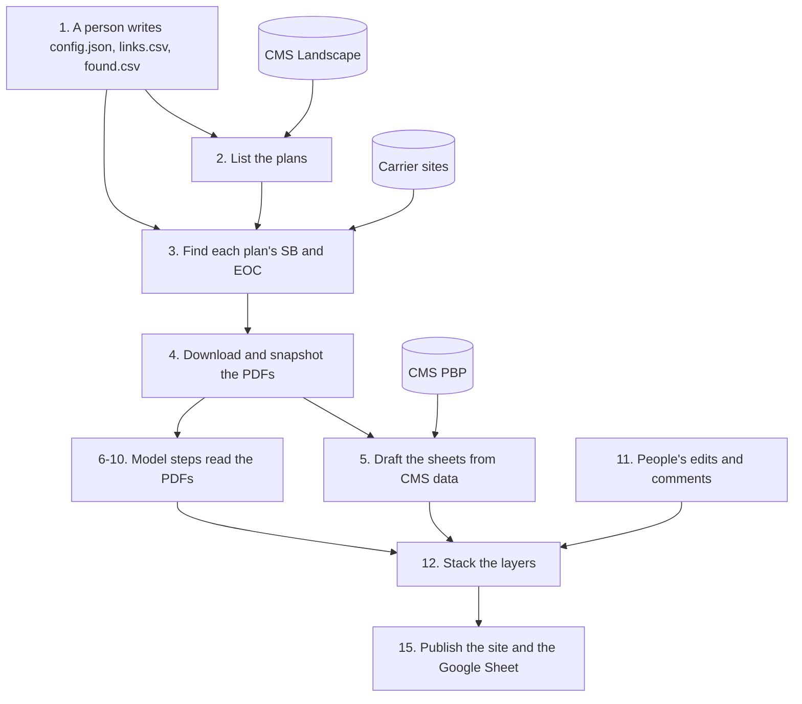

## 1. A person starts the year

A person writes these small inputs:

- `config.json` names the CMS file URLs, the state, the counties and the Google Sheet.
- `links.csv` copies the volunteers' list of PDF links.
- `found.csv` records PDF links that a person found, by hand or with a finder script (section 3).
- `steps.json` pins the version of each versioned model step (section 13).

## 2. List the plans

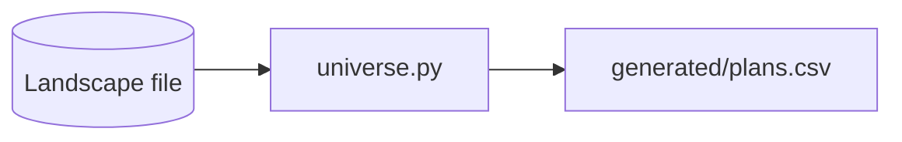

`universe.py` keeps the Medicare Advantage plans sold in every listed county. It drops plans for people with Medicaid or in institutions. For 2027 that leaves 39 plans.

A rerun rewrites `generated/` and `machine/`.

## 3. Find each plan's SB and EOC

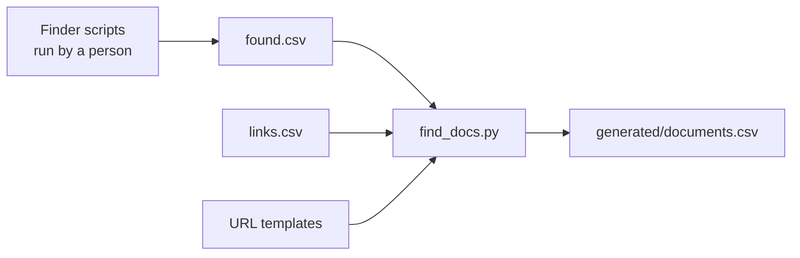

`find_docs.py` writes each plan's SB and EOC URLs to `generated/documents.csv`. For each plan and kind of document, it takes the first URL in `found.csv`, then in `links.csv`, then from URL templates for carriers whose URLs follow a pattern.

Three finder scripts read carrier sites with a headless browser and write `found.csv`: `find_on_carrier_pages.py`, `find_by_plan_page.py` and `find_regence.py`. A person runs them. `run.py` does not.

## 4. Download and snapshot the PDFs

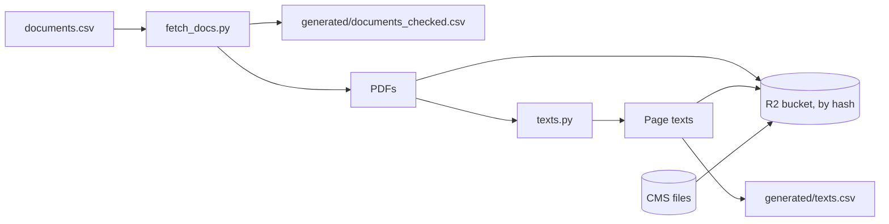

`fetch_docs.py` downloads each PDF and checks that its cover names the plan and says SB or EOC. It records each file's SHA-256 hash in `generated/documents_checked.csv`. `texts.py` extracts each page's text, and `generated/texts.csv` records the text files' hashes.

The PDFs, texts and CMS files are too big for git. The Pipeline workflow stores them in a Cloudflare R2 bucket, named by hash. So the committed hashes pin the exact bytes that every later step reads.

`run.py ... replay` downloads nothing. It skips `find_docs.py` and `fetch_docs.py`, and reads the CMS files, PDFs and texts from the snapshot.

## 5. Draft the sheets from CMS data

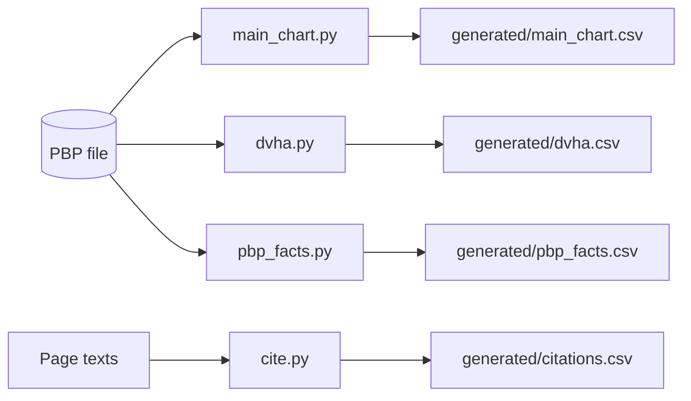

`main_chart.py` and `dvha.py` fill every cell of both sheets from the PBP file. `pipeline/fields.py` holds each column's rules. `pbp_facts.py` writes the PBP's terms as facts (section 8).

CMS data is quick to parse, but nobody can cite it, so later sections cite its values from the PDFs or replace them. The PBP has no naturopathy category, so `cite.py` finds naturopathy in the PDFs and writes `generated/citations.csv`.

## 6. Model steps and saved answers

A **model step** asks a Claude model to read the PDFs. Each one writes a prompt file, a **task**, per plan or document, and a model answers it. The model steps run only for the `LIVE` year, in this order: `blanks.py`, `document_facts.py`, then `present.py`, which uses no model but reads the facts, then `filled.py`.

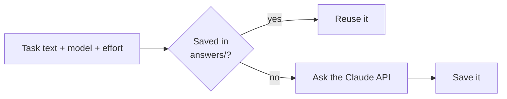

`ask.py` sends tasks through the Claude API's Message Batches, at half price. It saves each answer in `answers/`, keyed by a hash of the model, the effort and the task's text. A rerun with the same inputs asks nothing and costs nothing. A change to a prompt or to the facts' vocabulary changes the task text, so the next run asks those tasks again.

Without `api`, `run.py` stops at the first model step with unanswered tasks, and lists them. With `api`, the Claude API answers them.

Each model step checks its answers the same way:

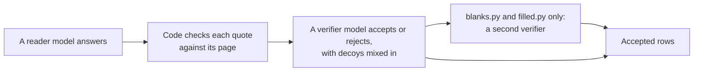

A **decoy** is a real answer moved to the wrong plan, setting or column. If a verifier accepts a decoy, the run fails.

## 7. Explain blank cells

`blanks.py` explains why a cell is blank: the plan excludes the benefit, covers only the Medicare part, or sells it as an option. It writes `machine/blanks.csv`.

It asks about the cells frozen in `machine/blanks_cells.json`, so later changes to the sheets leave its tasks unchanged. `python3 -I pipeline/blanks.py freeze` rewrites the file from the current layers.

## 8. Read facts from the PDFs

`pipeline/facts.py` defines a fact's fields and the words each field may use. Each fact keeps its quotes and page.

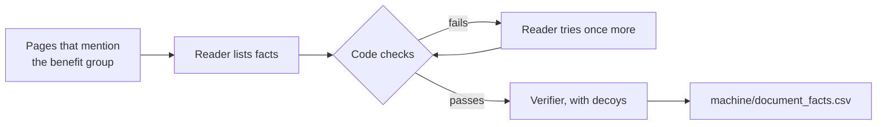

`document_facts.py` works through one benefit group at a time, such as imaging or ambulance. A reader model gets each document's pages that mention the group. Code checks each fact: its quote must appear exactly once on its page and show the amount. A fact that fails goes back to the reader once, and code drops it if it fails again. A verifier then checks the rest.

Version 10 of `document_facts.py` adds a second reader for plans whose readers missed a price. It sees the facts already found and lists only the missing ones.

Readers still miss some prices. `override_facts.csv` holds hand-written facts for those. Each has a note that says why, and the person who writes one also adds a yellow note to its cell in `comments.csv`.

## 9. Present the facts as cells

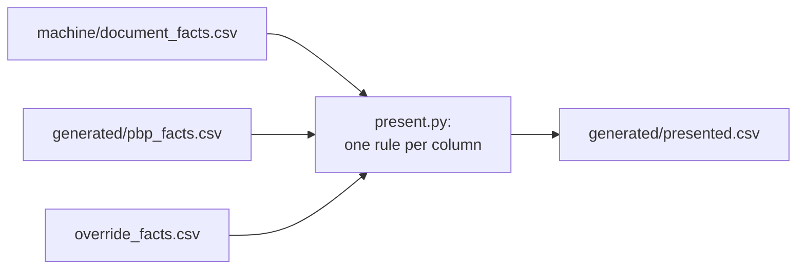

`present.py` holds one rule per column. A rule picks the facts it needs and shows a value, such as "$0-$250" or a dot. A rule uses facts from the best source: the EOC, then a rider, then the SB, then CMS data. The cell cites the quotes of the document facts the rule used. PBP facts have no page to cite, so a line that only they support keeps its CMS value.

`present.HELD` lists cells whose facts are incomplete. Those cells keep the value from the layers beneath (section 12).

Most main-sheet columns have rules. Every DVHA column keeps its CMS value, and so do the main sheet's two premium columns, out-of-pocket maximum and pharmacy deductible.

## 10. Cite the filled cells

`filled.py` finds an EOC quote for each dot or amount that no EOC or rider cites. A quote must show every amount in the cell. It writes `machine/filled.csv`.

## 11. People correct what is left

- `edits.csv` sets a cell's value. Each row records `saw`, the value it replaced. The site build warns when the value beneath an edit changes, so a person can check the edit. Most edits are on the DVHA sheet, whose columns have no rules yet.
- `comments.csv` adds a note to a cell, shown in yellow.
- `struck.csv` hides a model's quote that does not support its cell.

## 12. Stack the layers

Each file that can set or cite a cell is a **layer**. `pipeline/layers.py` stacks them in this order:

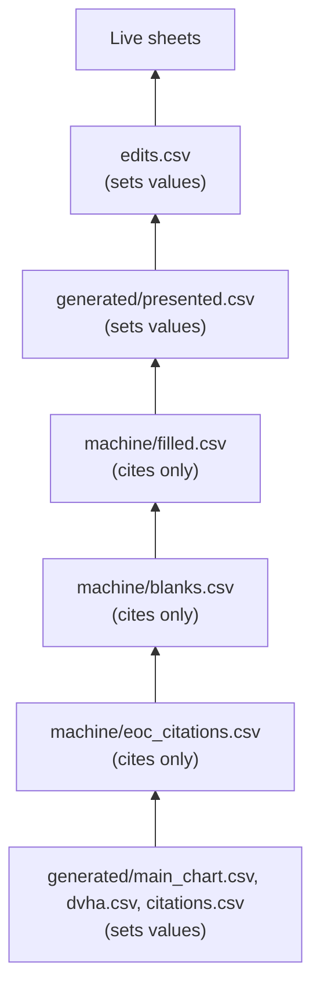

Among the layers that set values, a later one wins. The cite-only layers add citations: `machine/eoc_citations.csv` holds citations from earlier Claude sessions. `struck.csv` hides quotes from the cite-only layers. A citation whose value isn't the cell's final value is dropped.

## 13. Versioned model steps

A new prompt asks many tasks again, and that costs money. So `steps.json` pins a version of each versioned step, such as `{"filled": 6, "document_facts": 9}`. A version fixes which tasks its step writes. A **candidate** is an unpinned version that a run uses in place of the pin. Only workflows on main can sign in to the Claude API, so code on an unreviewed branch can't call it. A new version goes live in three stages:

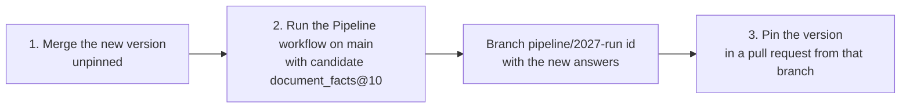

## 14. Checks on every pull request

The Site workflow checks every pull request with two jobs:

- `reproduce` runs `run.py ... replay` from the R2 snapshot and the saved answers, with no API access. It fails if any tracked file changes. So a change that would ask a model something new fails here, and needs the three stages above.
- `build` runs the site's and the pipeline's unit tests, builds the site, and opens each PDF the site links in a headless browser.

## 15. Publish

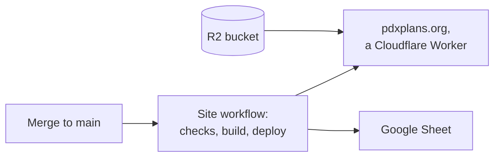

The Site workflow deploys pdxplans.org to a Cloudflare Worker, which serves the PDFs from R2. It then updates the Google Sheet in place, so volunteers' own comments stay on their cells. The Sheet's Details tab lists every fact.

## 16. Measuring the models

- `evaluate.py`, run by the Evaluate workflow, scores the fact readers and verifiers against an Opus reviewer and the expected cells in `pipeline/tests/fixtures/expected_cells.csv`.
- The Pipeline workflow's `rebuild` input reruns every model step from scratch into `rebuilds/<name>`. A full rebuild costs about $50.

## 17. Starting 2028

1. Write `data/2028/config.json`, `links.csv`, `found.csv` and `steps.json`.
2. Run the Pipeline workflow with year 2028. It builds `generated/` only, because 2028 isn't `LIVE`. Merge that branch.
3. Change `LIVE` to 2028 in `pipeline/years.py`, so the model steps run for 2028.

Step 3 has a known gap. Its pull request's `reproduce` check fails, because 2028 has no saved answers yet, and the Pipeline workflow can't answer them before the switch merges.
