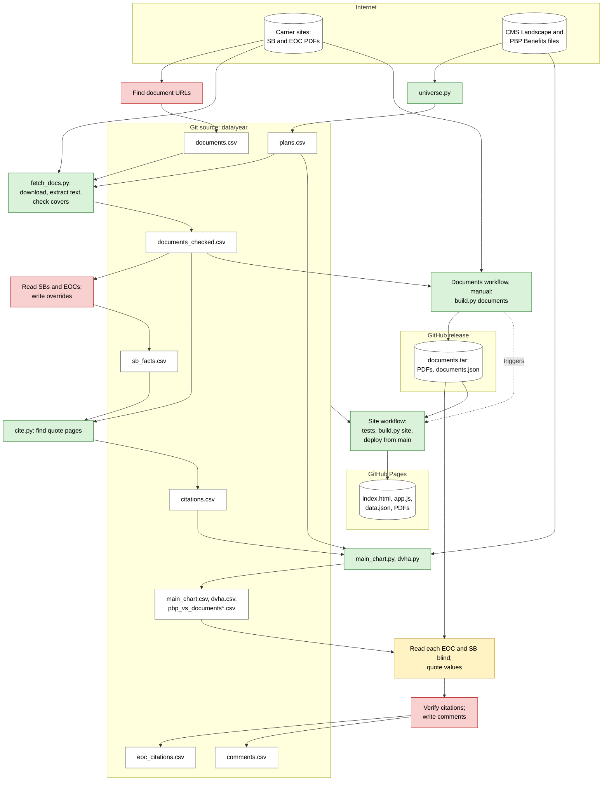

# Data pipeline

| Color | Step |
|---|---|
| Green | Deterministic code |
| Yellow | Cheap model (Haiku) |
| Red | Heavier model (Sonnet or Opus), or an agent with a browser |

- Steps in `pipeline/run.py` regenerate every CSV above except `documents.csv`, `sb_facts.csv`, `eoc_citations.csv` and `comments.csv`. Models write those four.
- The Site workflow downloads PDFs from carriers only when no documents release exists.
