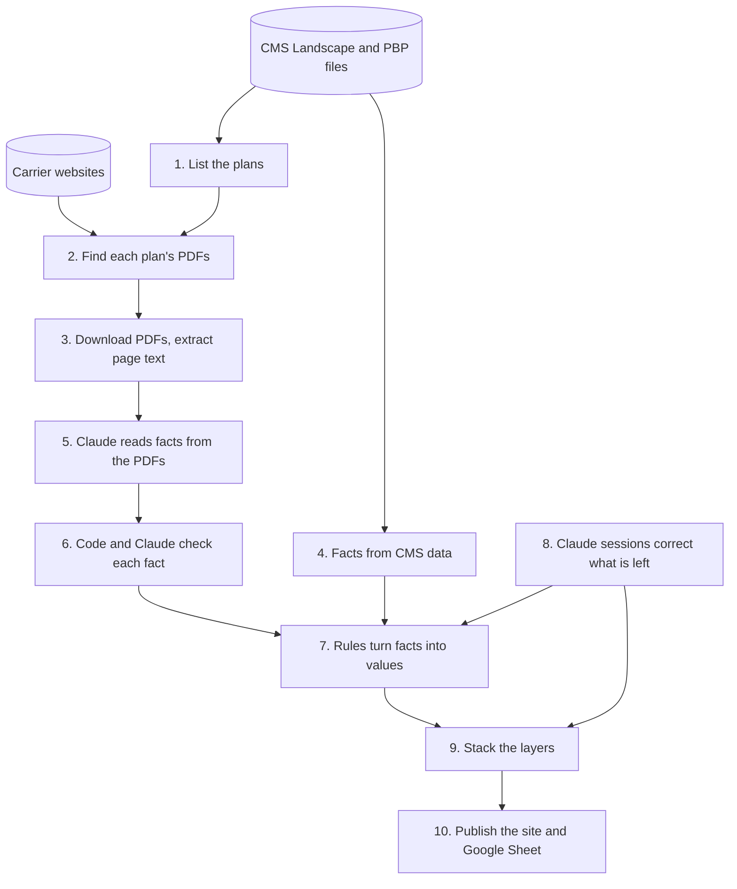

# How the plan sheets are made

SHIBA volunteers help people in Multnomah and Clackamas counties pick a Medicare Advantage plan.
They compare plans on two sheets: the **main sheet** (premiums, copays and benefits) and the **DVHA sheet** (dental, vision, hearing and other extras).

This page shows how the pipeline builds those sheets from public sources.
Every example is real 2027 data, and most follow one cell.
Each example names its table. Paths are relative to `data/2027/`.

## Terms

- **Medicare Advantage** plans are private plans that replace Original Medicare. Each sets its copays and extra benefits.
- **CMS** (the Centers for Medicare & Medicaid Services) publishes two files each year. The **Landscape** file lists plans and premiums. The **PBP** (plan benefit package) file holds what each plan told CMS it covers.
- Each plan publishes an **SB** (Summary of Benefits, about 10 to 25 pages) and an **EOC** (Evidence of Coverage, the full legal terms, about 200 pages). Some also publish a **rider** for optional benefits.
- A **cell** is one plan's entry in one column. Its **value** is the text it shows. A value can have several **lines**, separated by ` | `.
- A **quote** is text copied exactly from one page of a PDF.
- A **fact** is one cost that a document states for one plan, such as "ground ambulance, in network, $325 copay". Each fact carries its quotes and their page.
- A **citation** is a quote and its page, attached to one line of a cell. It shows a volunteer where the value comes from.

## The example cell

We follow the Ambulance cell of **Humana Total Complete (HMO)**, plan `H1036-153-0`. Its value ends up as:

```
Ambulance:  $325 or 20% | $325
            └─ in the U.S.  └─ outside the U.S.
```

On [pdxplans.org](https://pdxplans.org), a volunteer who clicks the cell sees the plan's EOC open beside the sheet, with this citation highlighted:

> **EOC page 46:** "In-Network: Emergency Ambulance $325 copayment per date of service regardless of the number of trips – Ground Ambulance 20% coinsurance regardless of the number of trips – Air Ambulance"

The plan's documents are the source of truth. CMS data fills some gaps, but a volunteer can't check a value without a citation. So rules prefer the documents' facts and cite their quotes.

## Who does what

- **A SHIBA domain expert** decided what information should go into which columns of the sheets
- **SHIBA volunteers** found plan document PDFs and curated draft of the sheets
- **Claude** AI was used in several ways, including:
  - locating the official sources for the PDFs on carrier websites
  - writing all code in this source repo, including code to download PDFs, and render the website and sheets
  - Some of that code calls other Claude models through the API to extract and review facts from the PDFs

## Steps



## 1. List the plans

The CMS Landscape file, `CY2027_Landscape_202610.csv`, has one row per plan per county, with about 50 fields. Here is part of our plan's Multnomah row:

```
Contract Plan Segment ID          = H1036_153_0
Plan Name                         = Humana Total Complete (HMO)
Organization Marketing Name       = Humana
Plan Type                         = HMO
Special Needs Plan (SNP) Indicator = No
Part C Premium                    = $0.00
In-Network Maximum Out-of-Pocket (MOOP) Amount = $5,150.00
Annual Part D Deductible Amount   = $700.00
Overall Star Rating               = 4.5
```

The pipeline keeps plans sold in both counties and drops plans only for people with Medicaid or in institutions. 39 plans remain for 2027. `generated/plans.csv`, selected columns:

```
plan_id,plan_name,plan_type,organization,premium,moop_in_network,part_d_deductible,...
H1036-153-0,Humana Total Complete (HMO),HMO,Humana,$0,"$5,150",$700,...
```

## 2. Find each plan's PDFs

CMS doesn't link the PDFs. The URLs come from three sources:

1. Carrier websites. Claude sessions drove a headless browser over each carrier's plan pages and recorded the links in `found.csv`. Humana needed no browser search, so this row is for a UnitedHealthcare plan:
   ```
   plan_ids,kind,url,found_via
   H3805-048-0,EOC,https://www.aarpmedicareplans.com/alphadog/AAOR27HP0418846_000,carrier plan page https://www.aarpmedicareplans.com/health-plans/details.html/97201/051/H3805048000/2027
   ```
2. The volunteers' Links sheet, copied to `links.csv`:
   ```
   plan_ids,kind,url
   H1036-153-0,EOC,https://assets.humana.com/is/content/humana/H1036153000EOC27pdf
   ```
3. URL patterns for carriers whose URLs are predictable, such as Humana's `H1036153000EOC27pdf`.

The pipeline takes the first URL it finds, in that order, for each plan and kind of document. `generated/documents.csv`:

```
plan_ids,kind,url,found_via
H1036-153-0,SB,https://assets.humana.com/is/content/humana/H1036153000SB27pdf,volunteers' Links sheet
H1036-153-0,EOC,https://assets.humana.com/is/content/humana/H1036153000EOC27pdf,volunteers' Links sheet
```

## 3. Download the PDFs and extract their text

The pipeline downloads each PDF. Code checks that its cover names the plan and says SB or EOC, and records its SHA-256 hash. `generated/documents_checked.csv`, selected columns:

```
plan_ids,kind,...,sha256,pages,...
H1036-153-0,SB,...,ce13e925c0384896d725da85a06c14dfbd268b422134b85b58640c8d7c494220,24,...
H1036-153-0,EOC,...,64e05773e847b56e0eeb5425979d54996c5f1975307c9ae186f5af4fecafc44c,188,...
```

Then code turns each page into text that keeps the page's columns. Models read this text. Each text file is named by its PDF's hash, and `generated/texts.csv` records the text files' hashes. Part of SB page 9, from `ce13e925c0384896.txt`:

```
=====PAGE 9=====
 SKILLED NURSING FACILITY (SNF)
 This plan covers up to 100 days in a SNF                  $10 copay per day for days 1-20
                                                           $221 copay per day for days 21-100
 AMBULANCE
 Air                                                       20% of the cost
 Ground                                                    $325 copay per date of service
 TRANSPORTATION
                                                           Not Covered
```

The PDFs, texts and CMS files are stored in a Cloudflare R2 bucket, named by hash, so every later run reads the same bytes.

## 4. Facts from CMS data

Plan documents rarely state some values, such as a $0 deductible. Code turns the plan's Landscape and PBP fields into facts whose source is `Landscape` or `PBP`. These rank below every document, so a rule uses one only when no document gives the value. Our plan's CMS facts in `generated/pbp_facts.csv`, selected rows and columns:

```
benefit             network  condition        cost_kind          amount  source     fields
medical_deductible  in                        deductible         $0      PBP        pbp_d_inn_deduct_yn
moop                in                        out_of_pocket_max  $5,150  PBP        pbp_d_out_pocket_amt
part_d_deductible   any      not tiers 1,2,3  deductible         $700    Landscape  Annual Part D Deductible Amount, …
```

A CMS fact has no quote, so a value built from one has no citation.

## 5. Claude reads facts from the PDFs

For each document and each benefit group, such as ambulance, the pipeline sends Claude one prompt. The prompt holds:

- the task and the rules for quoting,
- the words each field of a fact may use,
- only the pages that mention the group.

Here is the real prompt for our plan's SB and the ambulance group, shortened where marked `…`:

```markdown
# Task

You help Medicare counselors compare plans. Read the pages below from a plan's SB for plan year 2027, and list every
benefit fact they state about the benefits named below. A wrong fact is much worse than a missing one.

The document covers these plans:
- H1036-153-0: Humana Total Complete (HMO)

Seen in Humana documents: A benefit row lists each setting's cost on its own line, as in "$450 copayment – Outpatient Hospital".
…
benefit:
- `ambulance`: Ambulance services, ground and air, priced together
- `ambulance.ground`: Ground ambulance
- `ambulance.air`: Air ambulance, by airplane or helicopter

setting:
- `any`: The document names no setting, or one cost covers every setting
- `outside_us`: Outside the United States and its territories, as in a worldwide emergency benefit, …
…
A quote is text copied exactly from one page … Code checks that each quote occurs exactly once on its page, and that
the quotes show every number in the amount.
…
## Pages

=====PAGE 6=====
 WORLDWIDE COVERAGE
 If you have an emergency or urgently needed                • Emergency ambulance: $325 copay per date of
 service outside of the U.S and its territories, you will     service
…
=====PAGE 9=====
…
 AMBULANCE
 Air                                                       20% of the cost
 Ground                                                    $325 copay per date of service
```

Claude Opus (high effort) answered with three facts, using 3,479 input and 954 output tokens:

```json
[{"plan_id": "H1036-153-0", "benefit": "ambulance.air", "setting": "any", "network": "in", "covered_by": "medicare",
  "cost_kind": "coinsurance", "amount": "20%", "page": 9, "quotes": ["20% of the cost"]},
 {"plan_id": "H1036-153-0", "benefit": "ambulance.ground", "setting": "any", "network": "in", "covered_by": "medicare",
  "cost_kind": "copay", "amount": "$325", "unit": "per date of service", "page": 9,
  "quotes": ["$325 copay per date of service"]},
 {"plan_id": "H1036-153-0", "benefit": "ambulance", "setting": "outside_us", "network": "in", "covered_by": "medicare",
  "cost_kind": "copay", "amount": "$325", "unit": "per date of service", "page": 6,
  "quotes": ["Emergency ambulance: $325 copay per date of"],
  "note": "Worldwide coverage row. The network is not stated, so the in-network default is used. ..."}]
```

The same prompt for the 188-page EOC got five facts, including:

```json
{"plan_id": "H1036-153-0", "benefit": "ambulance.ground", "setting": "any", "network": "in", "covered_by": "medicare",
 "cost_kind": "copay", "amount": "$325", "unit": "per date of service", "condition": "Emergency Ambulance", "page": 46,
 "quotes": ["In-Network: Emergency Ambulance $325 copayment per date of service regardless of the number of trips – Ground Ambulance"]}
```

Every answer is saved under a hash of its model, effort and prompt. A rerun with the same prompts reuses the saved answers and calls no model. `answers/e920fcee050a431f.json` holds the SB answer above:

```json
{"model": "claude-opus-5-5", "effort": "high", "task": "ce13e925c0384896.md",
 "reply": "```json\n[{\"plan_id\": \"H1036-153-0\", \"benefit\": \"ambulance.air\", ...}]\n```",
 "usage": {"input_tokens": 3479, "output_tokens": 954}}
```

A reader misses some facts. For a few plans with incomplete values, a second prompt lists the facts already found and asks for the missing ones.

## 6. Code and Claude check each fact

**Code** checks that each quote occurs exactly once on its page, so the site can highlight it. It also checks that the quotes show every number in the amount.
A fact that fails goes back to the reader once, with the reason. Every ambulance fact for our plan passed, so this retry is from a UnitedHealthcare SB:

```
Failed:  {"benefit": "extras.chiropractic", "amount": "$15", "page": 6, "quotes": ["Medicare-covered $15 copay"]}
         -> quote not found exactly once on its page: "Medicare-covered $15 copay"
Retry:   {"benefit": "extras.chiropractic", "amount": "$15", "page": 6,
          "quotes": ["$15 copay", "manual manipulation of the spine to correct"]}
```

The page text shows those words on one line, but the PDF stores them apart, so the site can't highlight that quote.

**A verifier** (Claude Opus, medium effort) judges every fact against its pages. Code mixes in **decoys**: real facts with the plan, network or setting changed. If the verifier accepts a decoy, the run fails.
The SB's ambulance facts got no decoys. Here are two of the 14 items from the same SB's lab and test facts:

```json
{"id": 3,  "benefit": "tests.diagnostic", "setting": "office.specialist", "amount": "$30", "page": "6", "quotes": ["… Specialist's office: $30 copay • Urgent care center: $40 …"]}
{"id": 12, "benefit": "tests.diagnostic", "setting": "office.specialist", "amount": "$40", "page": "6", "quotes": ["… Specialist's office: $30 copay • Urgent care center: $ …"]}
```

Item 12 is a decoy, made from the urgent care fact. The verifier answered:

```json
{"id": 3,  "ok": true,  "reason": "Page 6 Diagnostic procedures and tests row: specialist's office $30 copay."},
{"id": 12, "ok": false, "reason": "Page 6 Diagnostic procedures and tests row: specialist's office is $30. The $40 is the urgent care center."}
```

The verifier also rejects real facts it doubts. It rejected the SB's worldwide ambulance fact:

```json
{"id": 1, "ok": false, "reason": "The page 6 Worldwide Coverage section does list emergency ambulance at $325 per date of service.
  However, Medicare does not cover care outside the U.S., so this is a supplemental benefit, not 'medicare'. ..."}
```

The EOC's worldwide fact, which says `supplemental`, passed.

**A reviewer** (Claude Opus, high effort) checks facts last. Code runs step 7's rules on the verified facts, and the reviewer checks each fact that a value would cite, one fact per prompt. `machine/reviewed_facts.csv` lists the facts it has checked, so a later run skips them. A real rejection, from another plan:

```json
{"id": 0, "ok": false, "reason": "Page 6, Diagnostic Tests and Procedures row: office or freestanding cost is '$0 or 50% coinsurance'.
  Reporting only a $0 copay leaves out the 50% coinsurance alternative, and the page does not say when $0 applies."}
```

Our plan's accepted ambulance facts, in `machine/document_facts.csv`, selected columns:

```
benefit           setting     network  condition                covered_by    cost_kind    amount  source  page
ambulance.ground  any         in       Emergency Ambulance      medicare      copay        $325    EOC     46
ambulance.ground  any         in       Non-Emergency Ambulance  medicare      copay        $325    EOC     46
ambulance.air     any         in       Emergency Ambulance      medicare      coinsurance  20%     EOC     46
ambulance.air     any         in       Non-Emergency Ambulance  medicare      coinsurance  20%     EOC     46
ambulance         outside_us  out      Emergency Ambulance      supplemental  copay        $325    EOC     46
ambulance.ground  any         in                                medicare      copay        $325    SB      9
ambulance.air     any         in                                medicare      coinsurance  20%     SB      9
```

2027 has about 5,800 accepted facts for 39 plans.

## 7. Rules turn facts into values

Each column has a rule, written in code from the domain expert's instructions. The Ambulance rule, in pseudocode:

```
line 1 (in the U.S.):
  facts = ground and air trips, in network, Medicare-covered, priced
  keep the facts from the best source: EOC, then rider, then SB, then CMS
  show the dollar range, "or", the percent range        -> "$325 or 20%"

line 2 (outside the U.S.), first match wins:
  facts = trips with setting outside_us, from the best source
  unclear      -> "EOC unclear"
  priced       -> show the range                        -> "$325"
  covered      -> line 1's value
  not_covered  -> "not covered"
```

Each line cites the quotes of the facts it used. `generated/presented.csv` has one row per citation:

```
sheet,plan_id,column,line,value,url,pdf_page,quote
main,H1036-153-0,AB_ambulance,1,$325 or 20%,…H1036153000EOC27pdf,46,In-Network: Emergency Ambulance $325 copayment per date of service regardless of the number of trips – Ground Ambulance
main,H1036-153-0,AB_ambulance,1,$325 or 20%,…H1036153000EOC27pdf,46,Non-Emergency Ambulance $325 copayment per date of service regardless of the number of trips – Ground Ambulance
…
main,H1036-153-0,AB_ambulance,2,$325,…H1036153000EOC27pdf,46,Worldwide Coverage $325 copayment per date of service regardless of the number of trips – Emergency Ambulance
```

Rules write every value to the draft sheets, `generated/main_chart.csv` and `generated/dvha.csv`. A line that only CMS facts back goes there without a citation.

Rules also read the added facts from step 8.

## 8. Claude sessions correct what is left

Some cells need judgment that no rule or reader handles. Claude sessions make those calls in pull requests and record them in four tables.

An **added fact** adds a fact the readers missed, with a note saying why. Step 7's rules read it like any other fact. `added_facts.csv`, selected columns:

```
plan_id,benefit,setting,cost_kind,source,page,quotes,note
H1372-003-0,ambulance,outside_us,not_covered,EOC,41,"[""Our plan doesn’t cover emergency services, urgently needed services,
  or any other services you get outside of the United States and its territories.""]",
  "The EOC excludes all care abroad, so it excludes ambulances there."
```

That fact makes line 2 of the AgeRight plan's Ambulance cell read `not covered`.

A **note** explains a cell to volunteers. A `added` note, in green, marks a value that uses an added fact. A `caveat`, in lavender, gives a settled detail the value leaves out. A `question`, in yellow, flags a value that needs a domain expert's check. `comments.csv`, selected columns:

```
sheet,plan_id,column,kind,comment,pdf_page,quote
main,H1372-003-0,AB_ambulance,added,"The EOC excludes all care abroad, so it excludes ambulances there.",41,"Our plan doesn’t cover …"
dvha,H1372-003-0,F_dental,caveat,"EOC page 57 says there is no coinsurance or copayment for supplemental dental benefits, … The EOC does not say how often the maximum resets.",57,"Maximum: $1,000 for"
main,H7199-002-0,L_xray_imaging,question,"EOC page 96 prices X-rays at $25 in every office setting. …",96,X-rays PCP's office: $25 copay
```

An **edit** sets a cell's value directly, with a citation. Edits remain only on the DVHA sheet. Each edit records `saw`, the value it replaced. The build warns if the value beneath an edit changes. `edits.csv`, selected columns:

```
sheet,plan_id,column,value,pdf_page,quote,saw,source
dvha,H3805-048-0,E_optional_packages,"Dental Platinum Rider $66/mo, max $1,500, replaces plan dental",97,It is offered to you for a monthly premium of $66,Dental Platinum Rider $66/mo,session
```

`source` is `session` on every edit: a Claude session wrote it.

A **strike** in `struck.csv` hides a machine quote that doesn't support its cell.

## 9. Stack the layers

A **layer** is a table whose rows set a cell's value, attach a citation to it, or both. Code applies the layers in order. When two layers set the same cell, the later one wins:

```
layer                                         sets values?  Ambulance               X-ray
generated/main_chart.csv, citations.csv  (7)  yes           $325 or 20% | $325      $0-$30 | $205-$330
machine/eoc_citations.csv                     no            (citations only)
generated/presented.csv                  (7)  yes           $325 or 20% | $325      $0-$30 | $205-$330
edits.csv                                (8)  yes           (none)                  (none)
──────────────────────────────────────────────────────────
live sheet                                                  $325 or 20% | $325      $0-$30 | $205-$330
```

Code drops a citation whose value differs from the cell's final value. So a quote never supports a value it doesn't show. `machine/eoc_citations.csv` holds citations that Claude sessions found before the pipeline existed.

## 10. Publish

Merging to main builds the site. The `pdxplans` Cloudflare Worker serves the site at [pdxplans.org](https://pdxplans.org), and serves the PDFs from R2. The same build updates the volunteers' Google Sheet in place, so their comments stay on their cells. The Sheet's Details tab lists every fact.

## Reproducible runs

- **Pinned versions.** `steps.json` pins each model step's version, such as `{"document_facts": 15, "present": 7}`.
- **Three-stage deploys.** Only workflows on main can call the Claude API. A new version (1) merges unpinned. (2) The Pipeline workflow runs it on main and pushes the new answers to a new branch, such as `pipeline/2027-41966948424`. (3) A pull request from that branch pins the version.
- **Pull request checks.** `reproduce` reruns the pipeline from R2 and the saved answers, with no API access, and fails if any table changes. `build` runs the tests, builds the site, and opens each linked PDF.
