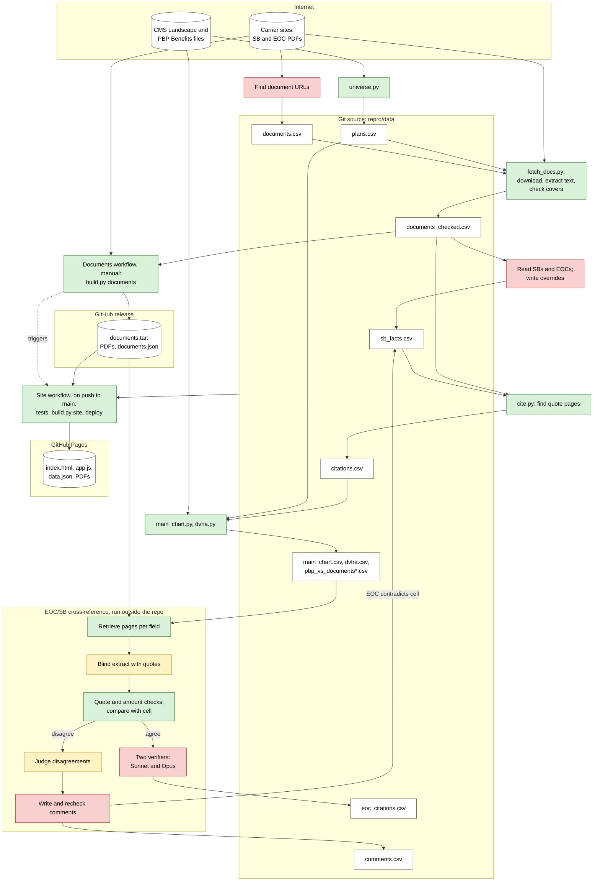

# Data pipeline

| Color | Step |
|---|---|
| Green | Deterministic code. |
| Yellow | Cheap model (Haiku). |
| Red | Heavier model (Sonnet or Opus), or an agent with a browser. |

- Steps in `repro/run.sh` regenerate every CSV above except `documents.csv`, `sb_facts.csv`, `eoc_citations.csv` and `comments.csv`. Those are written by models and reviewed in pull requests.
- The cross-reference scripts are not in the repo. Issue #8 describes them. The models ran as Claude Code subagents, not through the API.
- The Site workflow never contacts carriers. Only the Documents workflow downloads PDFs.
