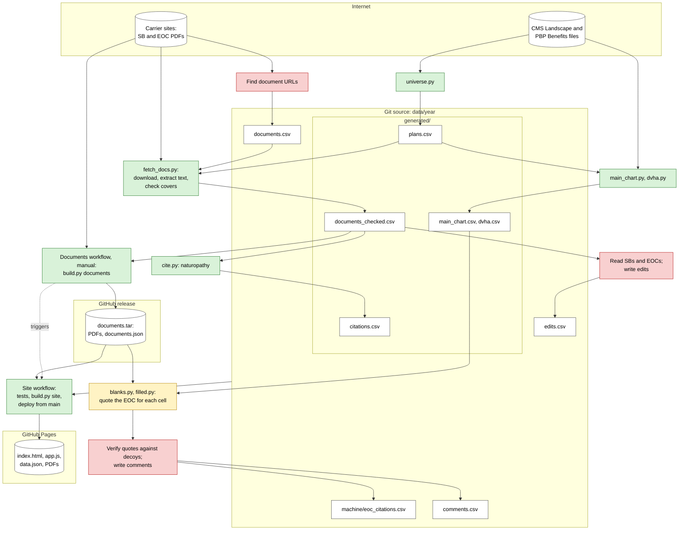

# Data pipeline

| Color | Step |
|---|---|
| Green | Deterministic code |
| Yellow | Cheap model (Haiku) |
| Red | Heavier model (Sonnet or Opus), or an agent with a browser |

- `pipeline/run.py` regenerates `generated/`. People and models write the other CSVs.
- `pipeline/layers.py` applies `generated/citations.csv` and then `edits.csv` to the generated sheets. Rows in `machine/eoc_citations.csv` only cite values.
- `pipeline/blanks.py` and `pipeline/filled.py` turn small-model answers into `machine/eoc_citations.csv` rows. Their docstrings list the steps.
- `pipeline/eval.py <year> [<machine.csv>]` scores machine-written cells against the live data.
- The Site workflow downloads PDFs from carriers only when no documents release exists.
