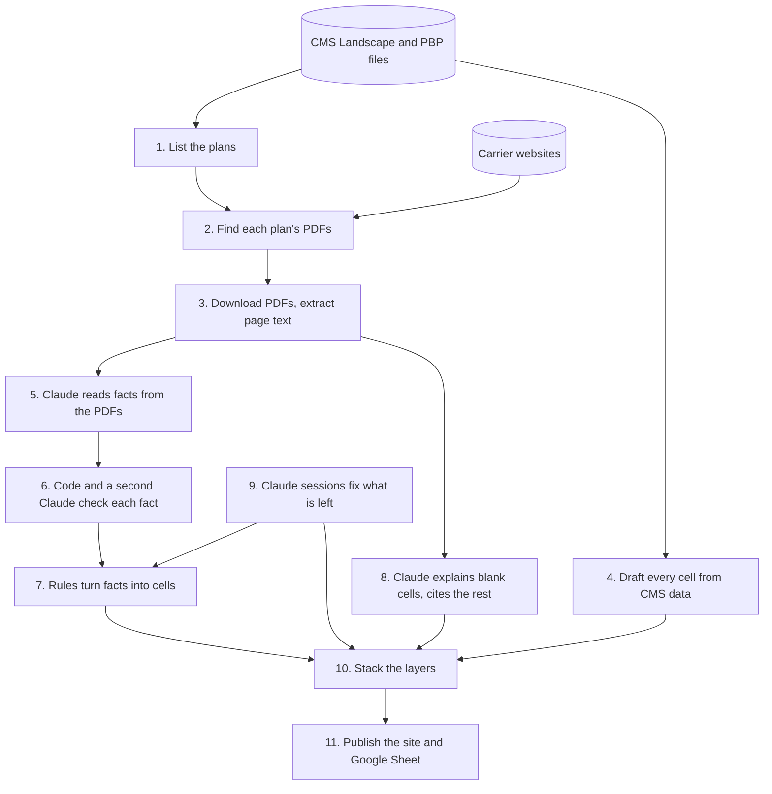

# How the plan sheets are made

SHIBA volunteers help people in Multnomah and Clackamas counties pick a Medicare Advantage plan.
They compare plans on two sheets: the **main sheet** (premiums, copays and benefits) and the **DVHA sheet** (dental, vision, hearing and other extras).
Each sheet has one row per plan and one column per benefit. A cell can hold several lines, separated by ` | `.

This page shows how those sheets are built from public sources.
Every example is real 2027 data, and most follow one cell.
Each example names its table. Paths are relative to `data/2027/`.

## Terms

- **Medicare Advantage** plans are private plans that replace Original Medicare. Each sets its own copays and extra benefits.
- **CMS** (the Centers for Medicare & Medicaid Services) publishes two files each year. The **Landscape** file lists plans and premiums. The **PBP** (plan benefit package) file holds what each plan told CMS it covers.
- Each plan publishes a **SB** (Summary of Benefits, about 10 to 25 pages) and an **EOC** (Evidence of Coverage, the full legal terms, about 200 pages). Some also publish a **rider** for optional benefits.
- A **fact** is one cost that a document states for one plan, such as "ground ambulance, in network, $325 copay".
- A **citation** is a quote and a PDF page that supports a cell.

## The example cell

The cell is the Ambulance column of **Humana Total Complete (HMO)**, plan `H1036-153-0`, which ends up as:

```
Ambulance:  $325 or 20% | $325
            └─ in the U.S.  └─ outside the U.S.
```

On [pdxplans.org](https://pdxplans.org), a volunteer who clicks the cell sees the plan's own Evidence of Coverage open beside the sheet, with this quote highlighted:

> **EOC page 46:** "In-Network: Emergency Ambulance $325 copayment per date of service regardless of the number of trips – Ground Ambulance 20% coinsurance regardless of the number of trips – Air Ambulance"

The plan's own documents are the source of truth. CMS data drafts the sheets, but a volunteer can't check it, so the pipeline replaces or confirms each value with a quote from a PDF.

## Who does what

- **A SHIBA domain expert** decided what each column should show, such as "line 2 of Ambulance is trips outside the U.S."
- **Claude Code sessions** wrote the code and prompts, found the PDFs on carrier websites, checked model output, and wrote the hand-written facts and notes in [step 9](#9-claude-sessions-fix-what-is-left).
- **Claude models**, called through the Claude API from GitHub Actions, read the PDFs during each pipeline run.
- **SHIBA volunteers** kept a Links sheet of PDF URLs, which is one input.

## Steps



## 1. List the plans

The CMS Landscape file, `CY2027_Landscape_202610.csv`, has one row per plan per county, with about 50 fields. Here is part of our plan's Multnomah row:

```
Contract Plan Segment ID          = H1036_153_0
Plan Name                         = Humana Total Complete (HMO)
Organization Marketing Name       = Humana
Plan Type                         = HMO
Special Needs Plan (SNP) Indicator = No
Part C Premium                    = $0.00
In-Network Maximum Out-of-Pocket (MOOP) Amount = $5,150.00
Annual Part D Deductible Amount   = $700.00
Overall Star Rating               = 4.5
```

The pipeline keeps plans sold in both counties, drops plans only for people with Medicaid or in institutions, and writes one row per plan. 39 plans remain for 2027.

`generated/plans.csv`, selected columns:

```
plan_id,plan_name,plan_type,organization,premium,moop_in_network,part_d_deductible,...
H1036-153-0,Humana Total Complete (HMO),HMO,Humana,$0,"$5,150",$700,...
```

## 2. Find each plan's PDFs

CMS doesn't link the PDFs, so the URLs come from three places:

1. Carrier websites. Claude sessions drove a headless browser over each carrier's plan pages and recorded what they found in `found.csv`:
   This row is for a UnitedHealthcare plan, because no browser search was needed for Humana:
   ```
   plan_ids,kind,url,found_via
   H3805-048-0,EOC,https://www.aarpmedicareplans.com/alphadog/AAOR27HP0418846_000,carrier plan page https://www.aarpmedicareplans.com/health-plans/details.html/97201/051/H3805048000/2027
   ```
2. The volunteers' Links sheet, copied to `links.csv`:
   ```
   plan_ids,kind,url
   H1036-153-0,EOC,https://assets.humana.com/is/content/humana/H1036153000EOC27pdf
   ```
3. URL patterns for carriers whose URLs are predictable, such as Humana's `H1036153000EOC27pdf`.

The pipeline takes the first URL it finds, in that order, for each plan and kind of document. `generated/documents.csv`:

```
plan_ids,kind,url,found_via
H1036-153-0,SB,https://assets.humana.com/is/content/humana/H1036153000SB27pdf,volunteers' Links sheet
H1036-153-0,EOC,https://assets.humana.com/is/content/humana/H1036153000EOC27pdf,volunteers' Links sheet
```

## 3. Download the PDFs and extract their text

The pipeline downloads each PDF, and code checks that its cover names the plan and says SB or EOC. It records each PDF's SHA-256 hash. `generated/documents_checked.csv`, selected columns:

```
plan_ids,kind,...,sha256,pages,...
H1036-153-0,SB,...,ce13e925c0384896d725da85a06c14dfbd268b422134b85b58640c8d7c494220,24,...
H1036-153-0,EOC,...,64e05773e847b56e0eeb5425979d54996c5f1975307c9ae186f5af4fecafc44c,188,...
```

Then each page becomes text that keeps the page's columns, which is what models read. The text files are named by the PDF's hash, and `generated/texts.csv` records their own hashes. Here is part of SB page 9, from `ce13e925c0384896.txt`:

```
=====PAGE 9=====
 SKILLED NURSING FACILITY (SNF)
 This plan covers up to 100 days in a SNF                  $10 copay per day for days 1-20
                                                           $221 copay per day for days 21-100
 AMBULANCE
 Air                                                       20% of the cost
 Ground                                                    $325 copay per date of service
 TRANSPORTATION
                                                           Not Covered
```

The PDFs, texts and CMS files are stored in a Cloudflare R2 bucket, named by hash, so any later run reads the same bytes.

## 4. Draft every cell from CMS data

Code reads the PBP file and writes a draft of both sheets, `generated/main_chart.csv` and `generated/dvha.csv`, with a value in every cell. The PBP is a set of tables, one per benefit category. Our plan's ambulance fields, from `pbp_b10_amb_trans.txt` and `pbp_b4_emerg_urgent.txt`:

```
pbp_b10a_copay_gas_amt_min = 325.00    # ground ambulance copay
pbp_b10a_copay_gas_amt_max = 325.00
pbp_b10a_coins_aas_pct_min = 20        # air ambulance coinsurance
pbp_b10a_coins_aas_pct_max = 20
pbp_b4c_bendesc_ehc        = 111       # 2nd flag: worldwide emergency coverage
pbp_b4c_copay_amt_wet_min  = 325.00    # worldwide emergency transportation copay
```

These fields become the draft cell. `generated/main_chart.csv`, selected columns:

```
plan_id,plan_name,F_primary_care,L_xray_imaging,AB_ambulance
H1036-153-0,Humana Total Complete (HMO),$0,$0-$145 | $0-$345,$325 or 20% | $325
```

For ambulance, CMS data happens to match the EOC. For other columns it does not. The same plan's X-ray column:

```
                  X-rays      CT, MRI, PET
CMS draft         $0-$145     $0-$345       one range over every setting, including hospitals
Published         $0-$30      $205-$330     the expert's rule: office prices only (EOC page 60)
```

CMS data also has no page a volunteer can open. So steps 5 to 9 replace or confirm each value with a quote.

## 5. Claude reads facts from the PDFs

For each document and each benefit group (ambulance, imaging, tests, and so on), the pipeline sends Claude one prompt. It holds:

- the task and the rules for quoting,
- the words each field may use,
- only the pages that mention the group.

Here is the real prompt for our plan's SB and the ambulance group, shortened where marked `…`:

```markdown
# Task

You help Medicare counselors compare plans. Read the pages below from a plan's SB for plan year 2027, and list every
benefit fact they state about the benefits named below. A wrong fact is much worse than a missing one.

The document covers these plans:
- H1036-153-0: Humana Total Complete (HMO)

Seen in Humana documents: A benefit row lists each setting's cost on its own line, as in "$450 copayment – Outpatient Hospital".
…
benefit:
- `ambulance`: Ambulance services, ground and air, priced together
- `ambulance.ground`: Ground ambulance
- `ambulance.air`: Air ambulance, by airplane or helicopter

setting:
- `any`: The document names no setting, or one cost covers every setting
- `outside_us`: Outside the United States and its territories, as in a worldwide emergency benefit, …
…
A quote is text copied exactly from one page … Code checks that each quote occurs exactly once on its page, and that
the quotes show every number in the amount.
…
## Pages

=====PAGE 6=====
 WORLDWIDE COVERAGE
 If you have an emergency or urgently needed                • Emergency ambulance: $325 copay per date of
 service outside of the U.S and its territories, you will     service
…
=====PAGE 9=====
…
 AMBULANCE
 Air                                                       20% of the cost
 Ground                                                    $325 copay per date of service
```

Claude Opus (high effort) replied, using 3,479 input and 954 output tokens. The reply is saved in `answers/e920fcee050a431f.json`:

```json
[{"plan_id": "H1036-153-0", "benefit": "ambulance.air", "setting": "any", "network": "in", "covered_by": "medicare",
  "cost_kind": "coinsurance", "amount": "20%", "page": 9, "quotes": ["20% of the cost"]},
 {"plan_id": "H1036-153-0", "benefit": "ambulance.ground", "setting": "any", "network": "in", "covered_by": "medicare",
  "cost_kind": "copay", "amount": "$325", "unit": "per date of service", "page": 9,
  "quotes": ["$325 copay per date of service"]},
 {"plan_id": "H1036-153-0", "benefit": "ambulance", "setting": "outside_us", "network": "in", "covered_by": "medicare",
  "cost_kind": "copay", "amount": "$325", "unit": "per date of service", "page": 6,
  "quotes": ["Emergency ambulance: $325 copay per date of"],
  "note": "Worldwide coverage row. The network is not stated, so the in-network default is used. ..."}]
```

The same group from the 188-page EOC gives five facts, including:

```json
{"plan_id": "H1036-153-0", "benefit": "ambulance.ground", "setting": "any", "network": "in", "covered_by": "medicare",
 "cost_kind": "copay", "amount": "$325", "unit": "per date of service", "condition": "Emergency Ambulance", "page": 46,
 "quotes": ["In-Network: Emergency Ambulance $325 copayment per date of service regardless of the number of trips – Ground Ambulance"]}
```

One reader misses about a quarter of the facts. So for a few plans whose cells came out incomplete, a second reader sees the facts already found and lists only the missing ones.

## 6. Code and a second Claude check each fact

**Code checks** each fact: the quote must occur exactly once on its page, so the site can highlight it, and must show every number in the amount.
A fact that fails goes back to the reader once, with the reason. Our plan's facts all passed, so this retry is from a UnitedHealthcare SB:

```
Failed:  {"benefit": "extras.chiropractic", "amount": "$15", "page": 6, "quotes": ["Medicare-covered $15 copay"]}
         -> quote not found exactly once on its page: "Medicare-covered $15 copay"
Retry:   {"benefit": "extras.chiropractic", "amount": "$15", "page": 6,
          "quotes": ["$15 copay", "manual manipulation of the spine to correct"]}
```

The page lays the words out on one line, but the PDF's own text stores them apart, so the viewer could not highlight that quote.

**A verifier** (Claude Opus, medium effort) then judges every fact against its pages. Code mixes in **decoys**: real facts with one field moved to the wrong plan, network or setting. If the verifier accepts a decoy, the run fails.
Our plan's ambulance facts got no decoys, so here are items 3 and 12 of 14 from the same SB's lab and test facts:

```json
{"id": 3,  "benefit": "tests.diagnostic", "setting": "office.specialist", "amount": "$30", "page": "6", "quotes": ["… Specialist's office: $30 copay • Urgent care center: $40 …"]}
{"id": 12, "benefit": "tests.diagnostic", "setting": "office.specialist", "amount": "$40", "page": "6", "quotes": ["… Specialist's office: $30 copay • Urgent care center: $ …"]}
```

Item 12 is a decoy, made from the urgent care fact. The verifier replied:

```json
{"id": 3,  "ok": true,  "reason": "Page 6 Diagnostic procedures and tests row: specialist's office $30 copay."},
{"id": 12, "ok": false, "reason": "Page 6 Diagnostic procedures and tests row: specialist's office is $30. The $40 is the urgent care center."}
```

The verifier also rejects real facts it doubts. For the SB's worldwide ambulance fact above:

```json
{"id": 1, "ok": false, "reason": "The page 6 Worldwide Coverage section does list emergency ambulance at $325 per date of service.
  However, Medicare does not cover care outside the U.S., so this is a supplemental benefit, not 'medicare'. ..."}
```

So that fact is dropped. The EOC's version, marked supplemental, survives.

**A reviewer** (Claude Opus, high effort) checks facts last. The pipeline runs step 7's rules on the accepted facts, and the reviewer checks each fact a cell would cite, one fact per prompt. It skips facts an earlier run reviewed, which `machine/reviewed_facts.csv` lists. A real rejection, from another plan:

```json
{"id": 0, "ok": false, "reason": "Page 6, Diagnostic Tests and Procedures row: office or freestanding cost is '$0 or 50% coinsurance'.
  Reporting only a $0 copay leaves out the 50% coinsurance alternative, and the page does not say when $0 applies."}
```

The accepted facts for our plan's ambulance, in `machine/document_facts.csv`, selected columns:

```
benefit           setting     network  condition                covered_by    cost_kind    amount  source  page
ambulance.ground  any         in       Emergency Ambulance      medicare      copay        $325    EOC     46
ambulance.ground  any         in       Non-Emergency Ambulance  medicare      copay        $325    EOC     46
ambulance.air     any         in       Emergency Ambulance      medicare      coinsurance  20%     EOC     46
ambulance.air     any         in       Non-Emergency Ambulance  medicare      coinsurance  20%     EOC     46
ambulance         outside_us  out      Emergency Ambulance      supplemental  copay        $325    EOC     46
ambulance.ground  any         in                                medicare      copay        $325    SB      9
ambulance.air     any         in                                medicare      coinsurance  20%     SB      9
```

2027 has about 5,800 facts for 39 plans.

## 7. Rules turn facts into cells

Each column has a rule, written in code from the domain expert's instructions. The Ambulance rule, in pseudocode:

```
line 1 (in the U.S.):
  facts = ground and air trips, in network, Medicare-covered, priced
  keep the facts from the best source: EOC, then rider, then SB, then CMS
  show the dollar range, "or", the percent range        -> "$325 or 20%"

line 2 (outside the U.S.), first match wins:
  facts = trips with setting outside_us, from the best source
  unclear      -> "EOC unclear"
  priced       -> show the range                        -> "$325"
  covered      -> line 1's price
  not_covered  -> "not covered"
```

The output cell cites the quotes of the facts it used. `generated/presented.csv`:

```
sheet,plan_id,column,line,value,url,pdf_page,quote
main,H1036-153-0,AB_ambulance,1,$325 or 20%,…H1036153000EOC27pdf,46,In-Network: Emergency Ambulance $325 copayment per date of service regardless of the number of trips – Ground Ambulance
main,H1036-153-0,AB_ambulance,1,$325 or 20%,…H1036153000EOC27pdf,46,Non-Emergency Ambulance $325 copayment per date of service regardless of the number of trips – Ground Ambulance
…
main,H1036-153-0,AB_ambulance,2,$325,…H1036153000EOC27pdf,46,Worldwide Coverage $325 copayment per date of service regardless of the number of trips – Emergency Ambulance
```

Rules also read the hand-written facts from step 9. Most main-sheet columns have rules. Columns without one, including every DVHA column, keep their CMS value or a correction from step 9.

## 8. Claude explains blank cells and cites the rest

Two more model steps cover cells that step 7 doesn't.

**Blank cells.** A blank cell claims the plan lacks the benefit. Claude Haiku reads the EOC passages that mention it and says why. The prompt, shortened:

```markdown
Each field below is BLANK on the sheet, which claims the plan does not have that benefit. Below each field are all EOC
passages that mention it, in printed layout. …
- `covered`: the plan itself covers the benefit, as the field defines it, in the base premium. The blank is wrong.
- `excluded`: a passage states the plan does not cover it, …
- `medicare_only`: only for acupuncture and chiropractic. …
- `not_mentioned`: the passages are about something else …
```

For our plan's Naturopath cell, Haiku replied:

```json
{"key": "main.U_naturopath", "result": "excluded",
 "citations": [{"page": 84, "quote": "Naturopath services (uses natural or alternative treatments) Not covered under any condition"}],
 "reason": "The exclusions table lists naturopath services as not covered under any condition."}
```

That becomes a citation for the blank cell. `machine/blanks.csv`:

```
step,prompt,sheet,plan_id,column,line,value,url,pdf_page,quote
blanks,3223a3015019,main,H1036-153-0,U_naturopath,,,…H1036153000EOC27pdf,84,Naturopath services (uses natural or alternative treatments) Not covered under any condition
```

**Filled cells.** Claude Haiku finds an EOC quote for a value that has none yet. Our plan needed none, so this row is for a DVHA vision cell of a UnitedHealthcare plan. `machine/filled.csv`, selected columns:

```
sheet,plan_id,column,value,pdf_page,quote
dvha,H2001-045-0,G_vision,exam $0/year; eyewear $200/year,116,$0 copayment or 1 pair o eyeglasses (lenses/ rames) or contact lenses with a retail value o up to $200.
```

The quote is missing its f's because the PDF draws that letter as a separate glyph. Quotes keep the PDF's own text, so the viewer can highlight them.

In both steps, code checks each quote, and Claude Sonnet and then Claude Opus verify it, with decoys, as in step 6.

## 9. Claude sessions fix what is left

Some cells need judgment that no rule or reader handles. Claude sessions make those calls in pull requests, and they land in four files.

A **hand-written fact** fills a gap the readers left, with a note saying why. Step 7's rules read it like any other fact. `override_facts.csv`, selected columns:

```
plan_id,benefit,setting,cost_kind,source,page,quotes,note
H1372-003-0,ambulance,outside_us,not_covered,EOC,41,"[""Our plan doesn’t cover emergency services, urgently needed services,
  or any other services you get outside of the United States and its territories.""]",
  "The EOC excludes all care abroad, so it excludes ambulances there."
```

That fact makes the AgeRight plan's Ambulance line 2 read `not covered`.

A **yellow note** flags uncertainty on a cell for volunteers. `comments.csv`, selected columns:

```
sheet,plan_id,column,kind,comment,pdf_page,quote
main,H1372-003-0,AB_ambulance,note,"Hand-written fact: The EOC excludes all care abroad, so it excludes ambulances there.",41,"Our plan doesn’t cover …"
```

An **edit** sets a cell's value directly. Edits remain only on the DVHA sheet, whose columns have no rules yet. Each records `saw`, the value it replaced, so the build warns if the value beneath it later changes. `edits.csv`, selected columns:

```
sheet,plan_id,column,value,pdf_page,quote,saw,source
dvha,H3805-048-0,E_optional_packages,"Dental Platinum Rider $66/mo, max $1,500, replaces plan dental",97,It is offered to you for a monthly premium of $66,Dental Platinum Rider $66/mo,session
```

`source` is `session` on every edit: a Claude session wrote it.

A **strike** hides a model's quote that doesn't support its cell. `struck.csv`:

```
sheet,plan_id,column,quote,note
main,H3805-048-0,T_chiropractic,Excluded rom Medicare coverage is any,Does not support the blank cell on its own.
```

## 10. Stack the layers

Each output that sets or cites cells is a **layer**. Layers stack from the CMS draft up, and a later layer that sets a value wins. Step 7 sits above step 8, so a presented value replaces the value step 8 cited:

```
layer                                         sets values?  H1036-153-0 X-ray cell
generated/main_chart.csv, citations.csv  (4)  yes           $0-$145 | $0-$345
machine/eoc_citations.csv                     no            (cites only)
machine/blanks.csv, machine/filled.csv   (8)  no            (cites only)
generated/presented.csv                  (7)  yes           $0-$30 | $205-$330     ← cites EOC page 60
edits.csv                                (9)  yes           (none)
──────────────────────────────────────────────────────────
live sheet                                                  $0-$30 | $205-$330
```

A citation whose value differs from the cell's final value is dropped, so a quote never supports a value it doesn't show. `machine/eoc_citations.csv` holds citations that Claude sessions made by hand.

## 11. Publish

Merging to main rebuilds and deploys [pdxplans.org](https://pdxplans.org), a Cloudflare Worker that also serves the PDFs from R2. The same build updates the volunteers' Google Sheet in place, so their own comments stay on their cells. The Sheet's Details tab lists every fact.

## Reproducible runs

- **Saved answers.** Every model reply is saved under a hash of its model, effort and prompt, in `answers/`. `answers/e920fcee050a431f.json`:
  ```json
  {"model": "claude-opus-5-5", "effort": "high", "task": "ce13e925c0384896.md",
   "reply": "```json\n[{\"plan_id\": \"H1036-153-0\", \"benefit\": \"ambulance.air\", ...}]\n```",
   "usage": {"input_tokens": 3479, "output_tokens": 954}}
  ```
  A rerun with the same inputs asks nothing and costs nothing. Changing a prompt changes its hash, so only the changed prompts are asked again.
- **Pinned versions.** `steps.json` pins each model step's version, such as `{"filled": 6, "document_facts": 11, "present": 2}`.
- **Three-stage deploys.** Only workflows on main can call the Claude API. A new version (1) merges unpinned, (2) runs on main and saves its answers to a branch, then (3) is pinned in a pull request from that branch.
- **Pull request checks.** `reproduce` reruns the whole pipeline from R2 and saved answers, with no API access, and fails if any output changes. `build` runs the tests, builds the site, and opens each linked PDF.

## Measuring the models

The Evaluate workflow scores candidate readers and verifiers against an Opus reviewer and a set of expected cells. On imaging in November 2026, one Opus reader found 882 facts, and the reviewer accepted 862. All readers together found 1,123 accepted facts, so one reader misses about a quarter.

## Starting 2028

1. Write `data/2028/config.json` (CMS file URLs, state, counties), `links.csv`, `found.csv` and `steps.json`.
2. Run the Pipeline workflow for 2028. It builds the CMS draft only. Merge that branch.
3. Set `LIVE = 2028` in `pipeline/years.py`. The site then shows 2028, and the model steps run for it.

Step 3 has a known gap: its pull request's `reproduce` check fails, because 2028 has no saved answers yet.

## Where the code lives

All paths are in `pipeline/` unless noted. Data paths are in `data/<year>/`.

| Step | Code | Output |
|---|---|---|
| Run everything | `run.py <year> <work_dir> [api\|replay] [<step>@<version>]` | |
| 1. List the plans | `universe.py` | `generated/plans.csv` |
| 2. Find PDFs | `find_docs.py`; finders `find_on_carrier_pages.py`, `find_by_plan_page.py`, `find_regence.py` (run by hand) | `generated/documents.csv` |
| 3. Download, extract text | `fetch_docs.py`, `texts.py` | `generated/documents_checked.csv`, `generated/texts.csv` |
| 4. CMS draft | `main_chart.py`, `dvha.py`, `pbp_facts.py`, `cite.py`; column rules in `fields.py` | `generated/main_chart.csv`, `dvha.csv`, `pbp_facts.csv`, `citations.csv` |
| 5-6. Facts | `document_facts.py`, `extract.py`, `review.py`, `ask.py`; vocabulary in `facts.py`; prompts `fact_prompt.md`, `vfact_prompt.md` | `machine/document_facts.csv`, `machine/reviewed_facts.csv` |
| 7. Present | `present.py` | `generated/presented.csv` |
| 8. Blanks, filled | `blanks.py`, `filled.py`; prompts `blank_prompt.md`, `filled_prompt.md` and their `v*` verifiers | `machine/blanks.csv`, `machine/filled.csv` |
| 9. Fixes | | `override_facts.csv`, `comments.csv`, `edits.csv`, `struck.csv` |
| 10. Layers | `layers.py` | |
| 11. Publish | `web/build.py`, `web/sheet_sync.py`; `.github/workflows/pages.yml` | |
| Versions | `steps.py` | `steps.json` |
| Evaluate | `evaluate.py`, `.github/workflows/evaluate.yml` | `evaluations/` |

Page text uses `pdftotext -layout`.
