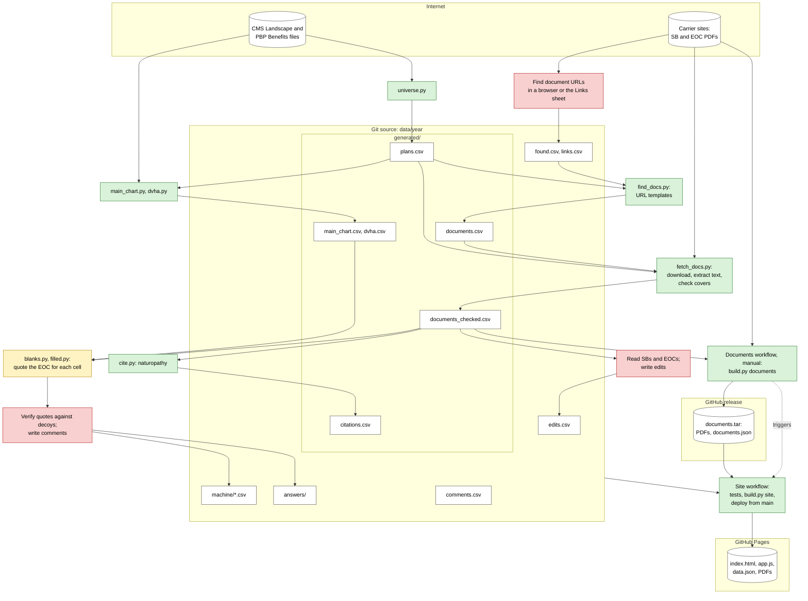

# Data pipeline

[pipeline-slides.md](pipeline-slides.md) walks through the same steps one slide at a time.

| Color | Step |
|---|---|
| Green | Deterministic code |
| Yellow | Cheap model (Haiku) |
| Red | Heavier model (Sonnet or Opus), or an agent with a browser |

- `pipeline/find_docs.py` lists plan documents from browser finds (`found.csv`), the volunteers' Links sheet (`links.csv`), and carrier URL templates, in that order of preference.
- `pipeline/run.py` regenerates `generated/`, `machine/blanks.csv` and `machine/filled.csv`. People and earlier Claude sessions wrote the other CSVs.
- The Pipeline workflow runs `run.py <year> <work> api` on main and pushes the result to a new branch. Only people with write access can start it.
- `pipeline/layers.py` applies `generated/citations.csv` and then `edits.csv` to the generated sheets. Rows in `machine/` only cite values.
- `pipeline/blanks.py` and `pipeline/filled.py` write model task files and turn the answers into `machine/` rows. Haiku reads, then Sonnet and Opus verify.
- `pipeline/ask.py` answers task files with the Claude API. It saves each answer in `answers/`, keyed by the model and the task's text, so a rerun calls a model only for new tasks.
- `pipeline/rebuild.py <year> <work> <name>` reruns the model steps with no saved answers or machine rows, on a copy with seeded errors. It saves the answers, rows and scores in `data/<year>/rebuilds/<name>`. The Pipeline workflow's `rebuild` input runs it.
- `pipeline/eval.py <year> [<machine.csv>]` scores machine-written cells against the live data. It also counts the edits that override the machine layer, by column and carrier.
- The Site workflow downloads PDFs from carriers only when no documents release exists.
